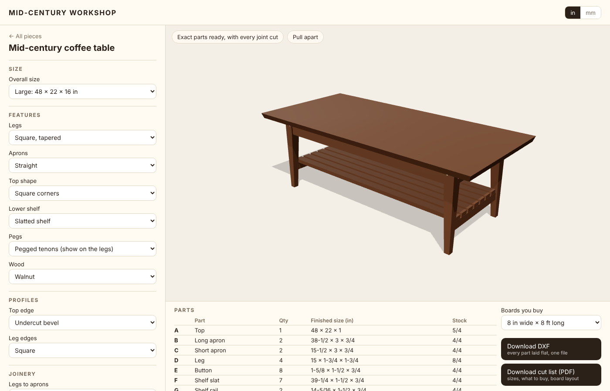

# Mid-Century Workshop

Design a mid-century modern coffee table from dropdowns, then download every part laid flat as a DXF and a PDF cut list showing the boards to buy and where each part is cut from. More pieces, and a community area for sharing designs, come later.

**Use it:** https://pjw3211.github.io/mid-century-workshop/ (live once the website is switched on, see below)

## What it does

1. **Choose a piece.** For now there is one: the mid-century coffee table.
2. **Pick from the dropdowns.**
   - **Size:** small, medium, large, long and low, or your own length, width and height.
   - **Features:** square or round legs, tapered or splayed; straight or arched aprons; top shape; a slatted or solid lower shelf; pegged tenons; the wood.
   - **Profiles:** the top edge (undercut bevel, square, eased, roundover, chamfer) and the leg edges.
   - **Joinery:** how the legs join the aprons (seven joints, from haunched mortise and tenon to pocket screws) and how the top is held on (buttons, Z-clips, figure-8s, corner blocks). Choices that don't go together are greyed out.
3. **Check it in 3D.** Every part is an exact solid with its joints cut. "Pull apart" spreads the parts so the joints show.
4. **Download.**
   - **DXF:** every part you make, laid flat side by side and labelled, in mm or inches. Cut lines on layer OUTLINE; mortises, holes and far-side edges on HIDDEN.
   - **Cut list (PDF):** the design, every part with finished and rough sizes, what to buy, and a drawing of each board with the parts marked on it.

Units switch between inches and millimetres at the top right.

## The plan

The full plan is in the [Full furniture app plan](https://claude.ai/artifact/JVkqRFMdhzktmLQWzZbYF8). This repository is a fresh start (October 2026) after the earlier living room designer in pjw3211/Furniture_App got too complicated. It has one piece, to get the whole pipeline (choices → exact parts → DXF and cut list) working end to end before adding more pieces.

## One-time setup (owner only)

To switch the website on: in this repository go to **Settings → Pages**, and under **Build and deployment → Source** choose **GitHub Actions**. After that, every change to `main` updates the site automatically.

## For developers

Requires Node 22.

    npm install
    npm run dev        # local site at http://localhost:5173
    npm test           # builds the table with every dropdown option: no overlapping parts, every joint joins
    npm run test:e2e   # opens the app in a browser, picks options and downloads the DXF and PDF

| Folder | Contents |
| --- | --- |
| `index.html`, `src/main.js` | The app: choose a piece, the dropdowns, the 3D view, downloads |
| `src/coffeeTable.js` | The coffee table's dropdown options and how a set of choices becomes the table's sizes (inches) |
| `src/cad/` | Exact solid engine (OpenCascade via [replicad](https://replicad.xyz), in a web worker): `table.js` builds the parts, shelf and pegs; `tableJoinery.js` the leg and top joints; `exports.js` the cut list and the flat DXF; `dxf.js` writes DXF with true arcs. Millimetres, Z up, front faces -Y |
| `src/cutlist/` | Board layout (`layout.js`) and the PDF cut list (`pdf.js`) |
| `src/cad/joinery/` | The joint recipes, also used for the reference models |
| `tests/`, `e2e/` | Tests for every option and the exports, browser tests for the app |
| `reference/coffee-table/` | The original coffee table parts from Fusion with `parts.json`, the joinery reference models and the Fusion scripts. Kept for accuracy tests; the app does not need Fusion |
